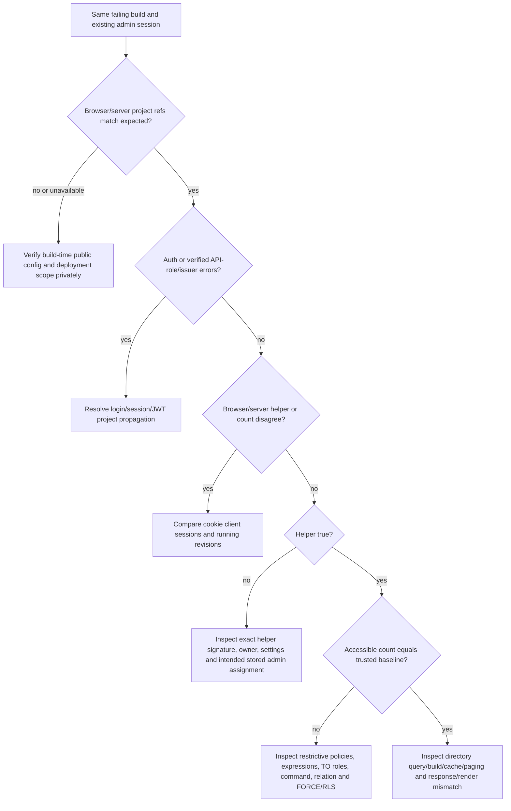

# Administrator visibility — evidence-driven diagnosis

14 November 2026. **Actual staging root cause remains unverified.** Owner reports
`ficudncgevvxsxbjscrk`, six profiles (admin/landlord/four tenants), postgres-owned
SECURITY DEFINER helper, authenticated EXECUTE/no anon EXECUTE, protected UPDATE
columns and an admin SELECT policy, but an app session previously saw one profile.
No matched live browser/server results or deployed metadata were available here.

## What current code proves

`app/admin/users/page.tsx` is force-dynamic, uses the cookie-bound public client,
selects `id,full_name,role,verification_status`, orders id and limits 100. It has
**no own-ID directory filter**. The separate server authorization reads the
caller's own stored role; successfully authorizing admin does not prove RLS admits
other profiles. No service-role key or RLS bypass is used.

`lib/diagnostics/admin-access.ts` calls getUser, verifies claims using getClaims,
checks API role/issuer-project consistency and obtains helper/count independently.
`/auth/diagnostics/server` is private, no-store, Cookie-varying and auth-validated.
Each side reports only projectReference, authenticatedRole, adminRpcResult,
accessibleProfileCount and bounded errorCodes. API role authenticated is expected;
profiles.role admin is a separate application concept. Null counts are not zero.
Existing browser/server diagnostic behavior and privacy contract are unchanged.

## Decision tree — no automatic SQL repair



- Wrong ref: public values are embedded at Next build time. An environment change
  without an approved rebuilt runtime does not update an existing browser bundle.
  Null custom-domain refs require private configuration confirmation, not guessing.
- Browser/server disagreement: the same project can still have stale/different
  sessions, cookie propagation or different revisions. Do not copy tokens/headers.
- Helper false: inspect exact zero-arg definition/overloads/defaults, owner and
  search_path/FORCE/RLS, then privately confirm the intended existing account has
  the protected stored admin role. A policy name cannot make a false helper true.
- Helper true/count one: inspect every SELECT/ALL policy including restrictive
  AND-combination, command and TO/inherited roles, exact relation/schema/type,
  helper execution context and effective SELECT. Do not add another permissive
  policy or reapply admin migrations just because one row remains visible.
- Helper true/count six but directory one: compare actual running commit, dynamic
  query/filters/pagination/cache and displayed response. Repository source currently
  has no own filter, so do not assert an application filter exists without evidence.
- `PGRST202`: missing/signature/schema-cache RPC discovery; `42501`: privilege;
  claims errors/project mismatch: authentication/environment before RLS repair.

## Local finding versus staging inference

Real PostgreSQL tests on synthetic data prove a restrictive own-profile policy
can produce **helper=true/count=1 while a working permissive admin policy exists**.
Removing that local test policy restores six accessible synthetic rows. This is a
controlled demonstration of one branch, **not evidence that staging has that
policy**. The local role mix/Auth adapter differ from staging and no real JWT
session was reproduced. Local successful admin access does not resolve the issue.

## Minimal owner-readable report template

Use the existing approved runtime; no new deployment or account is needed. Fill
only the following; do not include a screenshot/network export with private data.

```
Observed time + timezone:
Running application commit/revision:
Expected project reference: ficudncgevvxsxbjscrk

Browser:
  projectReference:
  authenticatedRole:
  adminRpcResult:
  accessibleProfileCount:
  errorCodes:
Server:
  projectReference:
  authenticatedRole:
  adminRpcResult:
  accessibleProfileCount:
  errorCodes:

Trusted aggregate profile baseline: 6 (1 admin, 1 landlord, 4 tenants), or corrected count
Metadata capture revision/time:
  relation kind/RLS/FORCE flags:
  SELECT/ALL policies: name + permissive/restrictive + TO roles + exact expression
  helper: exact signature + owner + SECURITY DEFINER + settings + effective EXECUTE
  effective SELECT/inherited-role anomalies, if any:
```

Collect metadata using the minimal read-only package from STAGING_INTEGRATION_RUNBOOK.md;
retain only metadata/aggregates and redact embedded private constants in custom
functions before sharing. No identity, email, user UUID, JWT, cookie/key, CNIC path,
bytes or SDK details. Only after this matched evidence identifies a confirmed gap
should a concrete minimal repair be prepared for approval, with rollback and actual
session validation. SQL-owner six-row counts alone are insufficient.
