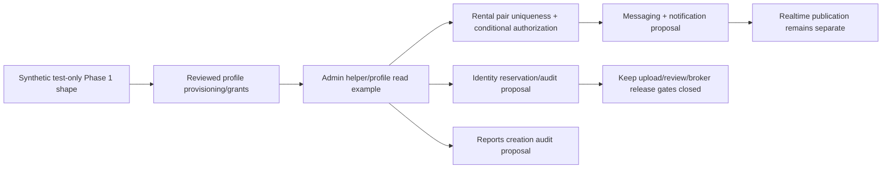

# Conditional database dependency strategy

14 November 2026. **Not a live deployment script.** No complete deployed DDL or
matched staging runtime evidence is available. The original Phase 1 baseline is
missing from the repository. Do not execute every file in supabase/migrations,
run blanket db push, infer schema versions from dates or apply local baseline.sql.

## Baseline identification before approval

Use existing five-field diagnostics and `preflight_integration_minimum_readonly.sql`
on the intended project only. Record revision/environment, relation kinds, column
UDTs/null/defaults, policy expression/roles/permissiveness, exact constraints/index
key columns/predicates/validity, FK actions/deferrability, triggers, schema ownership/
CREATE privileges, function overloads/owner/SECURITY DEFINER/search_path/EXECUTE,
and effective PUBLIC/inherited/table/column grants. Review metadata privately for
embedded secrets before sharing; no records or document/message payloads.

A baseline identifier should include reviewed metadata SHA256 plus the intended
project reference and app revision; the MD5 policy pin in proposals detects policy
drift only, not full schema identity or authorization. Never reuse the harness's
synthetic fingerprint against staging. Unknown objects/overloads need a new diff.

## Repository SQL classification — exact alternatives

| File in supabase/migrations | Classification / dependency |
| --- | --- |
| 20261025_milestone_1_2_auth_foundation.sql | Historical signup/profile/storage/legacy-submit bundle. Overlaps phase2 and exposes a weaker pending replacement contract. Not part of the selected local plan. |
| 20261026_profiles_emergency_grants_proposed.sql | Historical grant-only alternative; lacks complete provisioning/policy contract. Do not append just because grants once were broad. |
| 20261029_profiles_security_bundle_proposed.sql | Historical provisioning/grant alternative, depends on existing trigger and own policies. Conflicts with other replacements. |
| 20261101_staging_auth_phase2.sql | Selected local signup/profile contract on a synthetic Phase 1 shape; still requires exact deployed trigger/type/grant reconciliation for live use. |
| 20261112_admin_profile_read_staging_proposed.sql | Narrow helper/profile SELECT example, selected locally. Owner says helper/policy already exist; diagnose first, do not reapply as a guess. |
| 20261026_admin_verification_proposed.sql | Historical 3-arg review + identity_review_audit + broad object SELECT. Do not apply with v1. |
| 20261112_admin_verification_proposed.sql | Historical helper/policy and blanket admin storage SELECT alternative. Do not apply for a read-only profile issue. |
| 20261112_admin_review_audit_proposed.sql | Historical 2-arg review + identity_verification_reviews. Different reason/audit/version semantics. Retain history; revoke obsolete writes only by approved diff. |
| 20261114_core_rental_integrity_proposed.sql | Conditional full-history pair uniqueness. Now reuses an equivalent valid/ready full unique key; checks duplicates/nulls/conflicting names. Requires actual FK/non-null/index review and lock window. |
| 20261114_rental_authorization_proposed.sql | New conditional ownership/RLS/transition contract for a reviewed policy-free baseline. Existing policies/triggers/destructive FKs cause abort even with pin. Live replacement requires actual metadata-specific diff, not policy deletion guesses. |
| 20261114_identity_workflow_v1_proposed.sql | Selected reservation/finalize/review/audit proposal. Protected profiles, private bucket/metadata shape, reviewed policy pin, no existing v1 objects. Legacy overload EXECUTE must be effectively gone (including inheritance). Review remains ungranted. |
| 20261025_messaging_v2_proposed.sql | Historical alternative, not a precursor to run blindly: adds cascade FKs/direct INSERT and assumes old zero rows. |
| 20261114_messaging_notifications_v1_proposed.sql | Selected upgrade of existing two-party tables. Requires non-destructive FKs/valid participants/types, exact policy pin, no shadow notifications/v1 objects and retired alternate writers. |
| 20261114_property_reports_proposed.sql | Independent conditional creation-audit schema after protected roles/helper/schema confirmation. Existing reports objects abort. No moderation. |

Selected local sequence:

This graph describes the reproducible **local** baseline. Live changes are selected
only after evidence: skip already-correct objects; adapt only confirmed gaps; stop
on unknown data/policies or alternate privileged writers. Independent identity,
messaging and reports schemas must not grant private access merely because another
branch compiles. No monolithic deploy migration was created.

## Invariants required before a live release

- Trusted admin assignments only; protected profile INSERT/UPDATE denied through
  all effective grants and other RPCs. Helper owns a trusted RLS-capable context,
  empty search_path, exact no-argument contract; authenticated EXECUTE, no anon.
- RLS controls rows, column grants control mutable keys. Every mutation role and
  user-owned key verified at DB boundary; direct REST is an independent test.
- Applications pending→approved/rejected only; same actor/race cannot overwrite
  a settled outcome. Pair uniqueness is all-history, not a pending-only index.
- Preserve FK history. CASCADE/SET NULL/SET DEFAULT changes need exact constraint
  names and separately approved policy. No duplicate cleanup or auto-conversion.
- Messaging sender/recipient derived, immutable participants/history, nonce mapping
  persists with retained message; quota serialized; message/event/last-activity
  roll back together. All other direct/definer writers reconciled.
- Notification owner-only SELECT/mark, no client event creation/retarget/delete.
- Identity owner namespace/expiry/object checks, pending version + no self-review,
  delivery evidence and immutable audit in one transaction. A temporary local test
  grant is not a release recommendation. Broker, Storage API and retention remain gates.
- Report creation identity/status defaults + atomic audit; no moderation privileges.

## Rollback and recovery limits

Capture exact pre-change ACL/policy/function snapshots privately, backup/restore
verification, lock window, expected affected objects and smoke acceptance criteria
before approval. Existing *_rollback* files are fail-closed access off-switches or
empty-only rollback, not automatic baseline restoration. Do not restore broad
legacy grants, drop uniqueness/FKs or CASCADE/delete history to undo UI changes.
An audit-bearing change usually needs roll-forward and a separately approved
retention/erasure decision. Unknown dependencies stop rollback as well as deploy.

The physical migration directory still contains historical alternatives. Moving
approved proposals into a clean versioned release chain requires a later reviewed
consolidation once deployed metadata is known; it is not safe to pretend this
repository is currently replayable on an arbitrary Supabase project.
